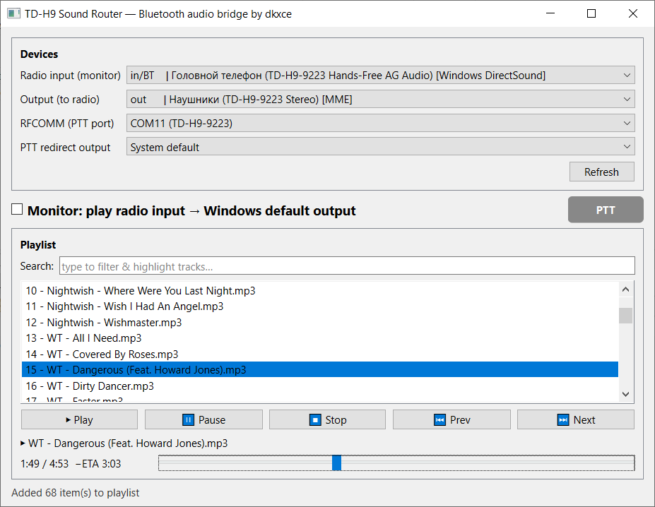

# TD-H9 Sound Router - Bluetooth audio bridge

[RU](README.md) | [EN](README.en.md) | [RELEASES](https://github.com/dkxce/tdh9ptt/releases)

Window app (PySide6/Qt) to work with Bluetooth headset
Tidradio TD-H9 (and similar) from a Classic Bluetooth computer (SCO/HFP).

Opportunities:

* choice**entrance**Device (in) - radio microphone on SCO/HFP;
* choice**weekend**Devices (out) – PC speakers/columns;
* choice**management**RFCOMM - PTT;
* switcher**radio**- taking voice from the radio.
* **Playing file**audio file playback (MP3/WAV/OGG/FLAC/M4A/AAC)
  to the selected output (if necessary, the channels are reduced to the device).

## Installation

Requires Python >= 3.11 and[Poetry](https://python-poetry.org/).

```
# cd sound-bt
# poetry env use "<path to python C:\...>"   # опционально
poetry install
```

## Dependencies:

```
numpy
sounddevice
miniaudio
pydub
pyside6
```

## Launch

```
poetry run sound-bt
# или
poetry run python -m sound_bt.app
```

## Use of use

1. In the list.**Radio input (monitor)**select a microphone device through
   The PC hears the radio (Hands-Free HFP input).
2. In the list.**Output (to radio)**Select the device through which you
   will**transmit**audio to the radio (file playback).
3. In the list.**-**Select the COM port of the radio through which
   The PTT button (PTT Odmaster) is controlled.
4. Mark.**Monitor**Everything that comes from the radio will be transmitted.
   on**Windows standard audio output**. While there's a real voice on the radio.
   (Physical PTT button pressed), light bulb lights up**PTT**.
5. **Playing file**Open the audio file (“Open File...”) and press “Play File”
   to transmit sound to the radio via the selected output device.

Closing the window stops the bridge and playback.

## Structure

```
sound_bt/
  __init__.py   версия
  core.py       аудиоядро: список устройств, StreamRouter (in→default out, VAD), play_file_to_device
  app.py        GUI на PySide6 (QMainWindow)
```

## How it works.

The voice of the radio is on Classic Bluetooth SCO/HFP. List of audio devices taken
through`sounddevice`(PortAudio) as full as possible.`StreamRouter`gripping
live input (headset microphone) at its native frequency and continuously transmits to**standard output**Resembling between in and out through`miniaudio.convert_frames`. The built-in PTT detect via RFCOMM determines,
If you press the transmission key, you read the audio stream from the radio.
When playing the file`miniaudio`frequency
Output devices, and channels are reduced to its capabilities.

## Screenshots



---

**Author**: [dkxcece](https://github.com/dkxce)   
**Android**: [dkxce/tdh9android](https://github.com/dkxce/tdh9android)   
**Desktop**: [dkxce/tdh9desktop](https://github.com/dkxce/tdh9desktop)   
**Manual**: [dkxce/Tidradio-TD-H9](https://github.com/dkxce/Tidradio-TD-H9)