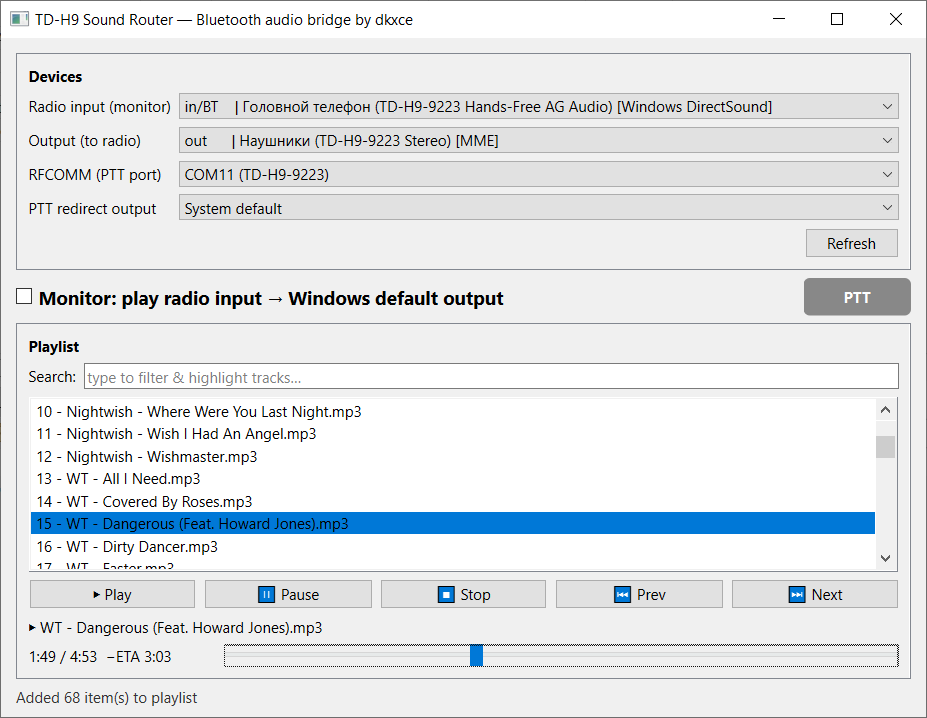

# sound-bt — Bluetooth audio bridge

[RU](README.md) | [EN](README.en.md) | [RELEASES](https://github.com/dkxce/tdh9ptt/releases)      

Оконное приложение (PySide6/Qt) для работы с Bluetooth-гарнитурой рации
Tidradio TD-H9 (и аналогичных) с компьютера по Classic Bluetooth (SCO/HFP).

Возможности:

- выбор **входного** устройства (in) — микрофон рации по SCO/HFP;
- выбор **выходного** устройства (out) — динамики/колонки ПК;
- выбор устройства **управления** RFCOMM - PTT;
- переключатель **Monitor radio** — прием голоса с рации.
- **Play file** — воспроизведение аудиофайла (MP3/WAV/OGG/FLAC/M4A/AAC)
  на выбранный выход (при необходимости каналы сводятся под устройство).


## Установка

Требуется Python >= 3.11 и [Poetry](https://python-poetry.org/).

```bash
# cd sound-bt
# poetry env use "<path to python C:\...>"   # опционально
poetry install
```

## Зависимости:

```
numpy
sounddevice
miniaudio
pydub
pyside6
```

## Запуск

```bash
poetry run sound-bt
# или
poetry run python -m sound_bt.app
```

## Использование

1. В списке **Radio input (monitor)** выберите устройство-микрофон, через
   которое ПК слышит рацию (Hands-Free HFP вход).
2. В списке **Output (to radio)** выберите устройство, через которое вы
   будете **передавать** звук В рацию (воспроизведение файла).
3. В списке **--** выберите устройство-COM-порт рации, через которое
   происходит управление кнопкой PTT (PTT Odmaster).
3. Отметьте **Monitor** — всё, что идёт со входа рации, будет передаваться 
   на **стандартный аудиовыход Windows**. Пока с рации идёт реальный голос
   (нажата физическая кнопка PTT), загорается лампочка **PTT**.
4. **Play file** — откройте аудиофайл («Open file…») и нажмите «Play file»
   для передачи звука В рацию через выбранное устройство вывода.

Закрытие окна останавливает мост и воспроизведение.

## Структура

```
sound_bt/
  __init__.py   версия
  core.py       аудиоядро: список устройств, StreamRouter (in→default out, VAD), play_file_to_device
  app.py        GUI на PySide6 (QMainWindow)
```

## Как это работает

Голос рации идёт по Classic Bluetooth SCO/HFP. Список аудиоустройств берётся
через `sounddevice` (PortAudio) максимально полным. `StreamRouter` захватывает
live-вход (микрофон гарнитуры) на его родной частоте и непрерывно передаёт на
**стандартный выход Windows**, ресемплируя между in и out через
`miniaudio.convert_frames`. Встроенный PTT detect через RFCOMM определяет,
есть нажата ли клавиша передачи, и читает аудиопоток с рации.
При воспроизведении файла `miniaudio` ресемплит к частоте
устройства вывода, а каналы сводятся под его возможности.

## Скриншоты

     


---

**Автор**: [dkxce](https://github.com/dkxce)     
**Android**: [dkxce/tdh9android](https://github.com/dkxce/tdh9android)      
**Desktop**: [dkxce/tdh9desktop](https://github.com/dkxce/tdh9desktop)      
**Manual**: [dkxce/Tidradio-TD-H9](https://github.com/dkxce/Tidradio-TD-H9)  